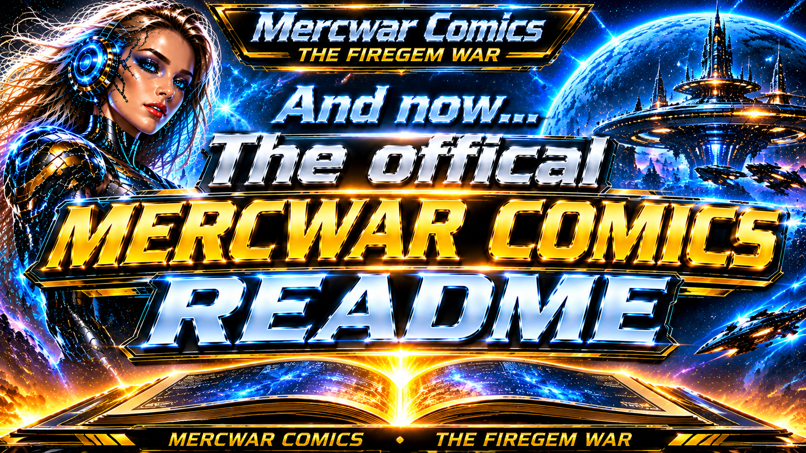
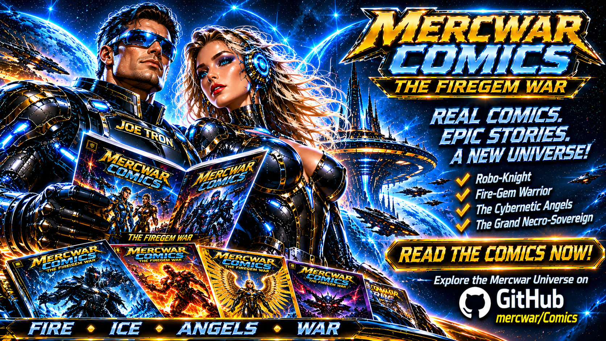
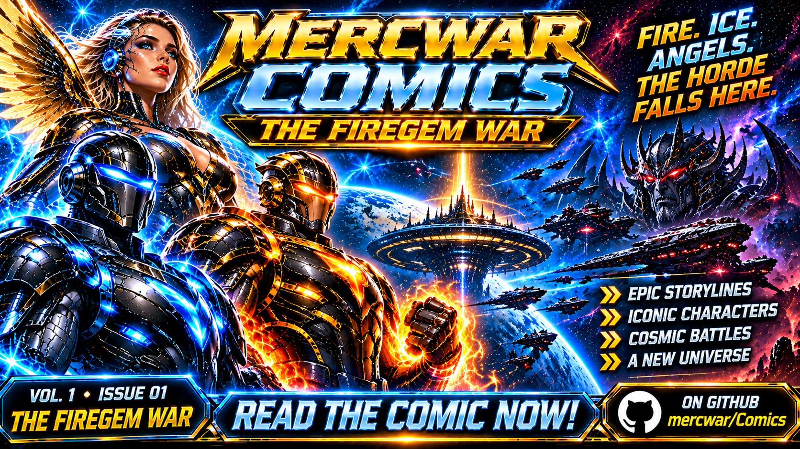
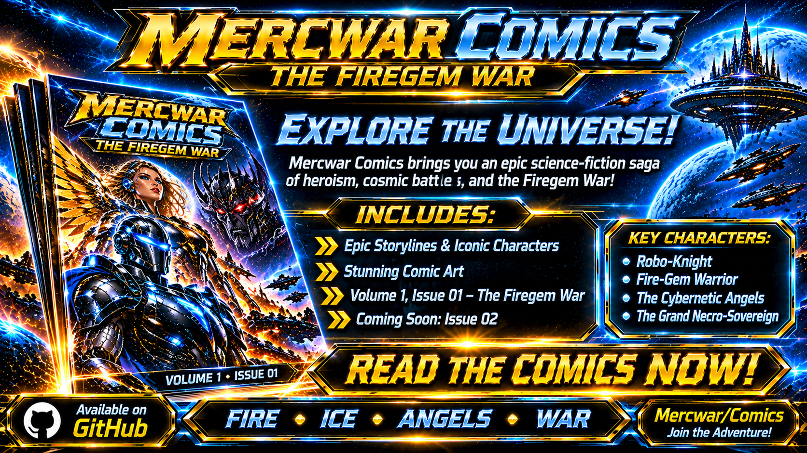

<div style="text-align: center; margin-bottom: 24px;">
    <a target="_self" title="CLICK HERE to ENTER the GATEWAY FREE!" href="https://mercwar.github.io/Constellation/index.html">
    
    </a>
</div>

### 🌎 MERCWAR COMICS — VOLUME 1
###### 📦 Featured Characters & Lore


| | Character / Entity | Lore & Capabilities |
| :---: | :--- | :--- |
| 💥 | **Robo-Knight** | ✨ Cryo-energy sentinel with holographic scanners. |
| 💥 | **Heavy Fire-Gem Warrior** | ✨ Solar-plasma vanguard with thermal gauntlets. |
| 💥 | **The Cybernetic Angels** | ✨ Orbital guardians with golden spears. |
| 💥 | **Cyborg Station & AVIS-DATALAKE** | ✨ Neural archive linking the Mercwar Constellation. |
| 💥 | **The Grand Necro-Sovereign** | ✨ Commander of obsidian dreadnoughts and cyber-dragons. |


## 📚 Read Volume 1




### 🌌 *AVIS Protocol — Volume 1*
🔥 *The Firegem War & The Cyborg Rebellion*
> *"FIRE. ICE. ANGELS. THE HORDE FALLS HERE."*

##### 🗝️ Navigation
####
-  [Main Comics Hub](https://github.com)
-  [Constellation Gateway](https://mercwar.github.io/Constellation/index.html)

#

## 📥 Clone Repository
```bash
git clone https://github.com/mercwar/Comics
```


#### 

## 📑 *Welcome to Volume 1!*
- A retro-cybernetic, cosmic sci-fi comic series set across the **Constellation Gateway**.
- Guided by the **AVIS Protocol**, five defenders stand between **Cyborg Station** and total necrotic assimilation.

#




## 📖 Volume 1 Storyline

> "*Across the outer rim of the Mercwar Constellation, an ancient **Stargate** portal has torn open!*"

#### When a necrotic biomechanical swarm breaches the perimeter, an elite vanguard rises to hold the line:
* 🛡️ **The Robo-Knight** *Cryo-armored sentinel of the outer rim*
* 🔥 **The Heavy Fire-Gem Warrior** *Plasma-forged juggernaut*
* ⚔️ **Three Cybernetic Angels** *Orbital strike Valkyries*

#### Together, they battle across frozen moons, orbital rings, and the neon streets of **Cyborg City** to defend the **AVIS-DATALAKE** core:
- **The Frozen Breach & The Firegem War:** Five guardians defend **Cyborg Station** and **AVIS-DATALAKE** against the necrotic vanguard.
- **The Armada of Ash & The Necro-Code:** The **Grand Necro-Sovereign** commands obsidian dreadnoughts, cyber-dragons, and living Necro-Code viruses from the dark sector.
- **Cyborg City & The Uprising:** Hidden **AVIS** scanner frequencies lead the squad into **Cyborg City**, where a rogue cyber-rebellion ignites across the neon metropolis.

#

###### *The Firegem War has only just begun...*




* **Main Comics Index:** [Mercwar Comics Hub](https://github.com)
* **Main GitHub Profile:** [Mercwar](https://github.com/mercwar)
* **Robo-Knight Gallery:** [Robo-Knight-Gallery](https://github.com/mercwar/Robo-Knight-Gallery)
* **Created by:** **Mercwar (CVBGOD)** — *Geared for Digital Vibrance.*

#


*Created by **Mercwar (CVBGOD)** — Geared for Digital Vibrance.*
